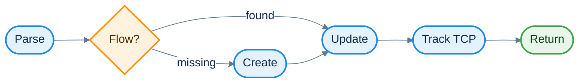
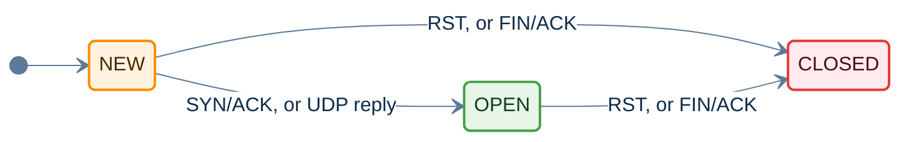
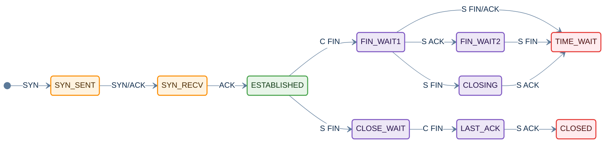
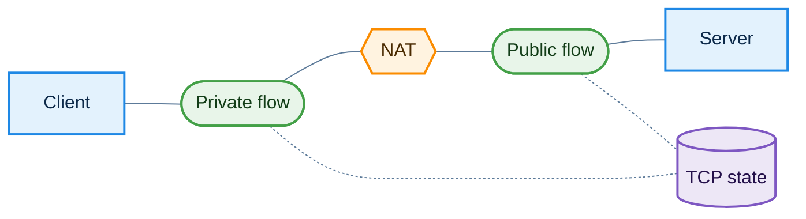

# inetflow

inetflow is a C library that groups IP packets into flows. It parses
Ethernet frames or IP packets, finds the flow that each packet belongs to,
and keeps a table of flows that expire when they go quiet. It can also check
packet headers for malformed fields, track IP fragments, and track the state
of TCP connections.

The library uses GLib and has no other runtime dependencies.

- [Features](#features)
- [Build](#build)
- [Quick start](#quick-start)
- [Concepts](#concepts)
- [API reference](#api-reference)
- [Memory ownership](#memory-ownership)
- [Threads](#threads)
- [The v1 API](#the-v1-api)
- [Porting from v1 to v2](#porting-from-v1-to-v2)
- [Development](#development)
- [Demo programs](#demo-programs)

## Features

- Parses Ethernet, 802.1Q and 802.1ad VLAN tags, MPLS labels, PPPoE, IPv4,
  IPv6 extension headers, TCP, UDP and SCTP.
- Optionally parses into GRE, IP in IP and IP in IPv6 tunnels.
- Matches both directions of a connection to one flow.
- Gives non-first IP fragments the ports of the first fragment.
- Expires flows with separate timeouts for new, open and closed flows.
- Reports malformed headers and options as anomaly flags.
- Detects overlapping and oversized IP fragments.
- Tracks TCP connections and reports segments that are invalid for the
  connection state, such as segments outside the receive window.
- Shares TCP state between the two flows of a connection that passes through
  address translation.

## Build

```sh
./autogen.sh
./configure
make
make install
```

The build needs autoconf, automake, libtool, pkg-config, GLib 2 and ncurses.
The demo programs also need libpcap, and `demo` uses libndpi when it is
installed.

Programs find the library with pkg-config:

```sh
cc -o app app.c $(pkg-config --cflags --libs inetflow)
```

## Quick start

```c
#include <inetflow.h>

static InetFlowTable *table;

void flows_init(void)
{
    table = inet_flow_table_new(NULL);
}

void flows_process(const guint8 *frame, guint length, guint64 timestamp_us)
{
    InetPacket pkt;
    InetFlow *flow;

    /* Find or create the flow of an Ethernet frame */
    flow = inet_flow_get(table, frame, length, timestamp_us,
                         INET_FLOW_L2 | INET_FLOW_CREATE | INET_FLOW_UPDATE, &pkt);
    if (flow)
        g_print("Flow has %" G_GUINT64_FORMAT " packets\n", flow->packets);
    else
        g_print("No flow, status %d\n", pkt.status);

    /* Free the flows that have expired */
    while ((flow = inet_flow_expire(table, timestamp_us)))
        inet_flow_free(flow);
}

void flows_shutdown(void)
{
    inet_flow_table_free(table);
    table = NULL;
}
```

Timestamps are in microseconds. A timestamp of 0 makes the library read the
monotonic clock.

## Concepts

### Packet processing

`inet_flow_get()` parses a frame, finds or creates its flow and updates it.
The flags passed to it select which steps run.

| Step | Flag | Without the flag |
|---|---|---|
| Parse | `INET_FLOW_L2`, `INET_FLOW_TUNNEL`, `INET_FLOW_VALIDATE` | The frame starts at the IP header, tunnels are not entered and options are not checked |
| Create | `INET_FLOW_CREATE` | A missing flow returns NULL with status `INET_PACKET_NOT_FOUND` |
| Update | `INET_FLOW_UPDATE` | The flow state, counters and expiry do not change |
| Track TCP | `INET_FLOW_TCP_TRACK` | The TCP fields of `InetPacket` hold only the header values |

Non-first fragments get their ports from the fragment list during the parse.



### Tuples

An `InetTuple` holds the two ends of a flow.

```c
typedef union _InetAddr {
    struct in_addr v4;
    struct in6_addr v6;
    guint8 bytes[16];
} InetAddr;                     /* An IPv4 address uses the first 4 bytes */

typedef struct _InetTuple {
    InetAddr src;               /* Source address */
    InetAddr dst;               /* Destination address */
    guint16 sport;              /* Source port, in network byte order */
    guint16 dport;              /* Destination port, in network byte order */
    guint8 family;              /* AF_INET or AF_INET6 */
    guint8 protocol;            /* IP protocol */
    guint16 offset;             /* Offset of the transport header in the frame */
    guint32 hash;               /* Set by inet_tuple_hash(), or 0 */
} InetTuple;
```

`inet_tuple_equal()` treats the two directions of a flow as equal.
`inet_tuple_exact()` compares the ends in order. The server end of a tuple is
the end with the lower port, or the lower address when the ports are equal.

### Flows

An `InetFlow` is one flow in a table. The library allocates it, and callers
read its fields directly. Callers change only `context`, which holds their own
data for the flow.

```c
typedef struct _InetFlow {
    InetTuple tuple;            /* The tuple of the first packet */
    InetFlowState state;        /* FLOW_NEW, FLOW_OPEN or FLOW_CLOSED */
    guint8 direction;           /* InetFlowDirection of the last packet */
    guint64 timestamp;          /* Time of the last packet, in microseconds */
    guint64 packets;            /* Packets in both directions */
    guint64 inbytes;            /* Bytes in the reply direction */
    guint64 outbytes;           /* Bytes in the original direction */
    gpointer context;           /* Owned by the caller, freed by the table */
} InetFlow;
```

Each flow state has its own timeout. `inet_flow_table_timeouts_set()` changes
the timeouts of a table.



| State | Default timeout |
|---|---|
| `FLOW_NEW` | 30 s |
| `FLOW_OPEN` | 300 s |
| `FLOW_CLOSED` | 10 s |

`inet_flow_establish()` and `inet_flow_close()` set the state of a flow, for
callers that learn about the connection another way.

The direction of a TCP packet is `FLOW_DIRECTION_ORIGINAL` when its
destination port is the destination port of the last SYN. The direction of a
UDP packet is `FLOW_DIRECTION_ORIGINAL` when its destination port is lower
than its source port.

### Packets

An `InetPacket` holds the details of one packet. The caller provides it,
usually on the stack, and `inet_flow_get()` or `inet_packet_parse()` fills it
in.

```c
typedef struct _InetPacket {
    InetPacketStatus status;    /* INET_PACKET_OK, or why no flow was returned */
    InetTuple tuple;            /* The tuple of the packet */
    const guint8 *l3;           /* IP header */
    const guint8 *l4;           /* Transport header, or NULL for non-first fragments */
    const guint8 *payload;      /* Transport payload for TCP, UDP and SCTP, or NULL */
    guint32 payload_length;     /* Bytes of payload, excluding link layer padding */
    guint8 direction;           /* InetFlowDirection, set when the flow is updated */
    gboolean fragment;          /* The packet is a fragment of a larger datagram */
    guint32 anomalies;          /* INET_ANOMALY_ flags for malformed headers */
    struct {
        guint16 flags;          /* FIN is bit 0, NS is bit 8 */
        guint16 window;         /* Not scaled */
        guint32 seq;            /* Host byte order */
        guint32 ack;            /* Host byte order */
        guint8 options;         /* INET_TCP_OPT_ flags, with INET_FLOW_VALIDATE */
        guint8 wscale;          /* Window scale option */
        guint16 mss;            /* Maximum segment size option */
        guint32 ts_val;         /* Timestamp option value */
        guint32 ts_ecr;         /* Timestamp option echo reply */
        InetTcpConnState state; /* Connection state before the packet, with TCP_TRACK */
        guint32 events;         /* INET_TCP_EVENT_ flags, with INET_FLOW_TCP_TRACK */
        gboolean invalid;       /* Invalid for the connection state, with TCP_TRACK */
    } tcp;
} InetPacket;
```

The pointers point into the frame passed to the library. For tunnelled
packets, all fields describe the innermost packet.

The status says why a lookup returned NULL:

```c
typedef enum {
    INET_PACKET_OK,
    INET_PACKET_PARSE_ERROR,    /* The frame could not be parsed, see anomalies */
    INET_PACKET_NOT_FOUND,      /* No flow, and INET_FLOW_CREATE was not set */
    INET_PACKET_TABLE_FULL,     /* No flow, and the table is full */
    INET_PACKET_FRAG_UNTRACKED, /* The fragment list is full */
} InetPacketStatus;
```

### Header anomalies

The parser sets an `INET_ANOMALY_` flag in `anomalies` for each problem it
finds. Checks that make the parse fail also set a flag, so a caller can tell
why. Option checks run only with `INET_FLOW_VALIDATE` or `INET_FLOW_TCP_TRACK`.

| Flag | Problem |
|---|---|
| `IP_VERSION` | The IP version is not 4 or 6 |
| `IPV4_TRUNCATED`, `IPV6_TRUNCATED` | The frame ends inside the IP packet |
| `IPV4_HLEN_TOO_SMALL` | The IPv4 IHL is less than 5 |
| `IPV4_LEN_TOO_SMALL` | The IPv4 total length is less than the header length |
| `IPV6_EXTHDR_TRUNCATED` | An IPv6 extension header extends past the packet |
| `TCP_TRUNCATED`, `TCP_HLEN_TOO_SMALL` | The TCP header extends past the packet, or its data offset is less than 5 |
| `UDP_TRUNCATED`, `UDP_LEN_INVALID` | The UDP header extends past the packet, or its length field is wrong |
| `IPV4_OPT_INVALID`, `TCP_OPT_INVALID` | An option length is invalid |
| `TCP_OPT_DUPLICATE` | A TCP option appears more than once |
| `FRAG_OVERLAP` | A fragment overlaps data already seen |
| `FRAG_TOO_LARGE` | A fragment ends past the maximum IP packet length |
| `FRAG_LIMIT`, `FRAG_EXPIRED` | The datagram could not be tracked, or its tracking timed out |

### Fragments

Only the first fragment of an IP datagram carries the ports. Each table has a
fragment list that records the first fragment of each datagram and gives its
ports to the later fragments. A datagram is identified by its source,
destination, protocol and IP ID.

The list records the byte ranges of each datagram, so it detects overlapping
fragments in any order. A datagram is tracked until all of its data has been
seen, or until it expires. By default the list holds 128 datagrams and each
expires after 30 seconds. `inet_flow_table_frag_limits_set()` changes this.

The library does not reassemble datagrams. Each fragment is returned as it
arrives.

### TCP tracking

With `INET_FLOW_TCP_TRACK`, the library tracks each TCP connection and checks
every segment against the connection state. It checks:

- the order and direction of the handshake segments
- SYN and SYN/ACK segments sent again
- data within the receive window, with window scaling
- acknowledgements of data that has not been sent
- RST segments within the receive window
- timestamps that go backwards or are missing (PAWS)
- data after a FIN

For each segment, `pkt.tcp.state` holds the state before the segment,
`pkt.tcp.events` holds `INET_TCP_EVENT_` flags, and `pkt.tcp.invalid` says
whether the segment is invalid. An invalid segment does not change the
tracked state. Retransmissions are reported but are valid.



C is the client and S is the server. An ACK in the closing states is an
acknowledgement of the FIN.

A valid RST in any tracked state moves the connection to `CLOSED`.

The first packet of a connection sets one of three starting states:

| First packet | State |
|---|---|
| SYN | `SYN_SENT` |
| SYN/ACK | `ONE_SIDED` |
| Any other | `UNTRACKED` |

A connection first seen after its handshake is not tracked, because its
sequence numbers and window scale are unknown. A connection where only one
direction of the handshake is seen moves to `ONE_SIDED`, and all of its
later segments are invalid. This also happens when the client sends an ACK
in `SYN_SENT`.

A caller that rejects a segment before the lookup, for example for a bad
checksum, leaves `INET_FLOW_TCP_TRACK` off for that segment. The segment then
does not change the connection state.

### Address translation

When a connection passes through address translation, its two sides have
different tuples, so they are two flows. If a caller sees the client packets
on one side and the server packets on the other, each flow sees one
direction. `inet_flow_tcp_link()` makes the two flows share one TCP state.



The caller passes the address and port of the client as they appear in the
linked flow, because the translation changes them.

## API reference

### Tables

| Function | Purpose |
|---|---|
| `inet_flow_table_new(context_free)` | Create a table. `context_free` frees the context of each flow that is freed, or is NULL. |
| `inet_flow_table_free(table)` | Free a table, its flows and its fragment list |
| `inet_flow_table_size(table)` | The number of flows |
| `inet_flow_table_max_set(table, max)` | Limit the number of flows. 0 means no limit. |
| `inet_flow_table_timeouts_set(table, new, open, closed)` | Set the flow timeouts in seconds |
| `inet_flow_table_frag_limits_set(table, max, timeout)` | Set the fragment list limits |

### Flows

| Function | Purpose |
|---|---|
| `inet_flow_get(table, frame, length, timestamp, flags, pkt)` | Parse a frame and find, create or update its flow. `pkt` can be NULL. |
| `inet_flow_lookup(table, tuple)` | Find the flow of a tuple |
| `inet_flow_create(table, tuple, timestamp)` | Create a flow for a tuple |
| `inet_flow_expire(table, timestamp)` | Return a flow that has expired, or NULL. The caller frees it. |
| `inet_flow_establish(table, flow)` | Set a flow open |
| `inet_flow_close(table, flow)` | Set a flow closed |
| `inet_flow_foreach(table, func, data)` | Call a function for each flow |
| `inet_flow_free(flow)` | Free a flow and its context |
| `inet_flow_tcp_state(flow)` | The tracked TCP state of a flow |
| `inet_flow_tcp_link(flow, linked, client, client_port)` | Share the TCP state of two flows |

### Flags

| Flag | Effect |
|---|---|
| `INET_FLOW_L2` | The frame starts with an Ethernet header, else an IP header |
| `INET_FLOW_TUNNEL` | Parse into GRE and IP in IP tunnels |
| `INET_FLOW_CREATE` | Create the flow if it does not exist |
| `INET_FLOW_UPDATE` | Update the flow state, counters and expiry |
| `INET_FLOW_VALIDATE` | Check IP and TCP options |
| `INET_FLOW_TCP_TRACK` | Track TCP connections. This also checks options. |

### Parsing without a table

| Function | Purpose |
|---|---|
| `inet_packet_parse(frame, length, flags, fragments, pkt)` | Parse a frame into an `InetPacket` without a flow table. `fragments` can be NULL. |
| `inet_frag_list_new(max, timeout)` | Create a fragment list for `inet_packet_parse()` |
| `inet_frag_list_free(fragments)` | Free a fragment list |

### Tuples

| Function | Purpose |
|---|---|
| `inet_tuple_set(tuple, family, protocol, src, sport, dst, dport)` | Fill in a tuple. Ports are in network byte order. |
| `inet_tuple_equal(a, b)` | TRUE for the same flow in either direction |
| `inet_tuple_exact(a, b)` | TRUE for the same flow in the same direction |
| `inet_tuple_hash(tuple)` | The hash of a tuple |
| `inet_tuple_server_addr(tuple)`, `inet_tuple_server_port(tuple)` | The server end |
| `inet_tuple_client_addr(tuple)`, `inet_tuple_client_port(tuple)` | The client end |
| `inet_tuple_to_sockaddr(tuple, src, out)` | Copy one end into a `struct sockaddr_storage` |
| `inet_tuple_family()`, `inet_tuple_get_protocol()`, `inet_tuple_get_src_port()`, `inet_tuple_get_dst_port()` | Field access macros |

## Memory ownership

| Object | Allocated by | Freed by |
|---|---|---|
| `InetFlowTable` | `inet_flow_table_new()` | `inet_flow_table_free()` |
| `InetFlow` | `inet_flow_get()` with `INET_FLOW_CREATE`, or `inet_flow_create()` | `inet_flow_free()`, or `inet_flow_table_free()` |
| `flow->context` | The caller | The table's `context_free` callback when the flow is freed. Without a callback, the caller frees it. |
| `InetPacket` | The caller | The caller. It holds no allocated memory. |
| Fragment list | `inet_frag_list_new()`, or the table | `inet_frag_list_free()`, or the table |
| TCP state | `inet_flow_get()` with `INET_FLOW_TCP_TRACK` | The library, when the last flow that uses it is freed |

No function returns memory that the caller must pass to `free()`. Callers
never allocate, copy or embed an `InetFlow`. The library allocates a larger
private structure for each flow, with the public part first.

## Threads

A flow table is not locked. Use each table from one thread, or lock it in the
caller. A program that processes packets on several threads can use a table
for each thread, as long as both directions of each flow reach the same
thread.

A fragment list has its own lock, so `inet_packet_parse()` calls on several
threads can share one fragment list.

## The v1 API

inetflow 1.x is maintained on the `v1` branch. Its API differs from v2 as
follows.

- `InetTuple` holds two `struct sockaddr_storage`, and callers read the
  addresses and ports through `sockaddr_in` and `sockaddr_in6` casts.
  `inet_tuple_get_lower()` and `inet_tuple_get_upper()` return pointers into
  the tuple, and `inet_tuple_get_server()` and `inet_tuple_get_client()` are
  aliases for them.
- `InetFlow`, `InetFlowTable`, `InetFragList` and `InetFragment` are public
  structures, including their internal fields.
- `inet_flow_get_full(table, frame, length, hash, timestamp, update, l2,
  inspect_tunnel, &iphr, &tuple)` finds or creates a flow. It always creates a
  missing flow. It can return the IP header pointer, and it allocates a tuple
  for the caller when `tuple` is not NULL.
- `inet_flow_get(table, frame, length)` is a short form of
  `inet_flow_get_full()`.
- `inet_flow_parse()` and `inet_flow_parse_ip()` parse a frame into a tuple
  and allocate the tuple when the caller passes NULL.
- `inet_flow_table_new()` takes no arguments. The flow timeouts and the
  fragment limits are fixed.
- `inet_flow_unref()` and `inet_flow_table_unref()` free flows and tables.
  The library never frees `flow->context`.
- There is no header validation, fragment range tracking or TCP tracking.

## Porting from v1 to v2

| v1 | v2 |
|---|---|
| `inet_flow_table_new()` | `inet_flow_table_new(context_free)`, or `inet_flow_table_new(NULL)` to free contexts yourself |
| `inet_flow_table_unref(table)` | `inet_flow_table_free(table)` |
| `inet_flow_unref(flow)` | `inet_flow_free(flow)` |
| `inet_flow_get_full(t, f, len, 0, ts, TRUE, TRUE, FALSE, NULL, NULL)` | `inet_flow_get(t, f, len, ts, INET_FLOW_CREATE \| INET_FLOW_UPDATE \| INET_FLOW_L2, NULL)` |
| `inet_flow_get_full(..., update = FALSE, ...)` | `inet_flow_get(..., INET_FLOW_CREATE \| ..., ...)`. Without `INET_FLOW_CREATE` a missing flow is not created. |
| `inet_flow_get_full(..., l2 = FALSE, ...)` | Leave out `INET_FLOW_L2` |
| `inet_flow_get_full(..., inspect_tunnel = TRUE, ...)` | Add `INET_FLOW_TUNNEL` |
| The `iphr` output of `inet_flow_get_full()` | `pkt.l3` |
| The tuple output of `inet_flow_get_full()` | `pkt.tuple`. Copy it to keep it. Remove the `free()`. |
| `inet_flow_get(t, f, len)` | `inet_flow_get(t, f, len, 0, INET_FLOW_CREATE \| INET_FLOW_L2, NULL)` |
| `inet_flow_parse(f, len, frags, &tuple, tunnel)` | `inet_packet_parse(f, len, INET_FLOW_L2 \| ..., frags, &pkt)`, then `pkt.tuple` |
| `inet_flow_parse_ip(ip, len, frags, &tuple, tunnel)` | `inet_packet_parse(ip, len, ..., frags, &pkt)`, then `pkt.tuple` |
| `inet_frag_list_new()` | `inet_frag_list_new(INET_FRAG_DEFAULT_MAX, INET_FRAG_DEFAULT_TIMEOUT)` |
| `((struct sockaddr_in *) &t->src)->sin_addr` | `t->src.v4` |
| `((struct sockaddr_in6 *) &t->src)->sin6_addr` | `t->src.v6` |
| `((struct sockaddr_in *) &t->src)->sin_port` | `t->sport` |
| `t->src.ss_family` | `t->family` |
| `inet_tuple_get_server(t)` or `inet_tuple_get_lower(t)` | `inet_tuple_server_addr(t)` and `inet_tuple_server_port(t)` |
| `inet_tuple_get_client(t)` or `inet_tuple_get_upper(t)` | `inet_tuple_client_addr(t)` and `inet_tuple_client_port(t)` |
| A `sockaddr` for a C library call | `inet_tuple_to_sockaddr(t, TRUE, &ss)` |
| Filling in `sockaddr` fields of a tuple | `inet_tuple_set()` |
| `table->hits`, `table->misses`, `flow->hash`, `flow->lifetime` and other internal fields | Not available |
| A `NULL` return from `inet_flow_get_full()` | Check `pkt.status` for the reason |
| `flow_context_unref(flow); inet_flow_unref(flow);` | `inet_flow_free(flow)`, with the context freed by the table callback |

Notes:

- Ports in the tuple stay in network byte order, as in v1.
- `inet_tuple_exact()` now compares the ports as well as the addresses.
- `inet_ntop(t->family, &t->src, buf, len)` works for both families, because
  the address is at the start of `InetAddr`.
- The library now cuts packets at the IPv4 total length or IPv6 payload
  length, so link layer padding is not counted as payload. Headers that extend
  past that length no longer parse.
- A fragmented datagram is tracked until all of its data has arrived, instead
  of until the fragment with the MF flag clear arrives.

## Development

```sh
make indent
make test
xdg-open gcov/index.html
```

`make test` builds the unit tests in `test.c`, runs them under valgrind and
writes a coverage report to `gcov/`. The tests include `inetflow.c`, so they
can check internal state. The GitHub workflow in `.github/workflows` runs the
unit tests under valgrind on each push and pull request, and fails on memory
errors or leaks. It can also be started by hand.

## Demo programs

`demo` prints the flows in a capture file or on an interface. It uses libndpi
to name applications when the library is installed.

```sh
make demo
./demo -p test.pcap -d
```

```
Usage:
  demo [OPTION...] - Demonstration of libinetflow

Application Options:
  -p, --pcap        Pcap file to use
  -d, --dpi         Analyse frames using DPI
  -v, --verbose     Be verbose
```

`inetmon` counts traffic for each host on a private network.

```sh
make inetmon
```
