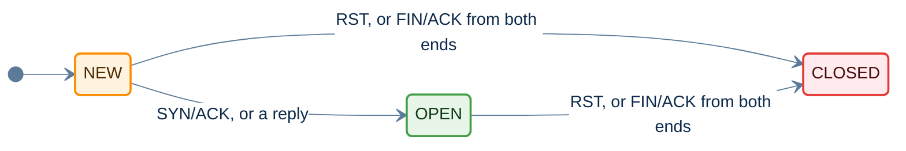
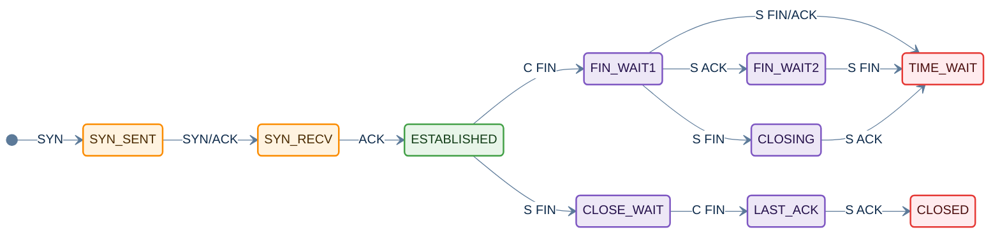

# inetflow

inetflow is a C library that groups IP packets into flows. It parses
Ethernet frames or IP packets, finds the flow that each packet belongs to,
and keeps a table of flows that expire when they go quiet. It can also check
packet headers for malformed fields, track IP fragments, and track the state
of TCP connections.

The library uses GLib and has no other runtime dependencies.

- [Features](#features)
- [Build](#build)
- [Quick start](#quick-start)
- [Concepts](#concepts)
- [API reference](#api-reference)
- [Memory ownership](#memory-ownership)
- [Threads](#threads)
- [The v1 API](#the-v1-api)
- [Porting from v1 to v2](#porting-from-v1-to-v2)
- [Development](#development)
- [Demo programs](#demo-programs)

## Features

- Parses Ethernet, 802.1Q and 802.1ad VLAN tags, MPLS labels, PPPoE, IPv4,
  IPv6 extension headers, TCP, UDP and SCTP.
- Optionally parses into GRE tunnels, and into IPv4 or IPv6 packets carried in
  IPv4 or IPv6.
- Matches both directions of a connection to one flow.
- Gives every fragment of an IP datagram the flow of its first fragment.
- Expires flows with separate timeouts for new, open and closed flows.
- Reports malformed headers and options as anomaly flags.
- Detects overlapping and oversized IP fragments.
- Tracks TCP connections and reports segments that are invalid for the
  connection state, such as segments outside the receive window.
- Shares TCP state between the two flows of a connection that passes through
  address translation.

## Build

```sh
./autogen.sh
./configure
make
make install
```

The build needs autoconf, automake, libtool, pkg-config, GLib 2 and ncurses.
The demo programs also need libpcap, and `demo` uses libndpi when it is
installed.

Programs find the library with pkg-config:

```sh
cc -o app app.c $(pkg-config --cflags --libs inetflow)
```

## Quick start

```c
#include <inetflow.h>

static InetFlowTable *table;

void flows_init(void)
{
    table = inet_flow_table_new();
}

void flows_process(const guint8 *frame, guint length, guint64 timestamp_us)
{
    InetPacket pkt;
    InetFlow *flow;

    /* Find or create the flow of an Ethernet frame */
    flow = inet_flow_get(table, frame, length, timestamp_us,
                         INET_FLOW_L2 | INET_FLOW_CREATE | INET_FLOW_UPDATE, &pkt);
    if (flow)
        g_print("Flow has %" G_GUINT64_FORMAT " packets\n", flow->packets);
    else
        g_print("No flow, status %d\n", pkt.status);

    /* Free the flows that have expired */
    while ((flow = inet_flow_expire(table, timestamp_us)))
        inet_flow_free(flow);
}

void flows_shutdown(void)
{
    inet_flow_table_free(table);
    table = NULL;
}
```

Timestamps are in microseconds. A timestamp of 0 makes the library read the
monotonic clock.

## Concepts

### Packet processing

`inet_flow_get()` parses a frame, finds or creates its flow and updates it.
The flags passed to it select which steps run.

| Step | Flag | Without the flag |
|---|---|---|
| Parse | `INET_FLOW_L2`, `INET_FLOW_TUNNEL`, `INET_FLOW_VALIDATE` | The frame starts at the IP header, tunnels are not entered and options are not checked |
| Create | `INET_FLOW_CREATE` | A missing flow returns NULL with status `INET_PACKET_NOT_FOUND` |
| Update | `INET_FLOW_UPDATE` | The flow state, counters and expiry do not change |
| Track TCP | `INET_FLOW_TCP_TRACK` | The TCP fields of `InetPacket` hold only the header values |

Later fragments get the flow tuple of their first fragment from the fragment
list during the parse. See [Fragments](#fragments).


### Tuples

An `InetTuple` holds the two ends of a flow.

```c
typedef union _InetAddr {
    struct in_addr v4;
    struct in6_addr v6;
    guint8 bytes[16];
} InetAddr;                     /* An IPv4 address uses the first 4 bytes */

typedef struct _InetTuple {
    InetAddr src;               /* Source address */
    InetAddr dst;               /* Destination address */
    guint16 sport;              /* Source port, in network byte order */
    guint16 dport;              /* Destination port, in network byte order */
    guint8 family;              /* AF_INET or AF_INET6 */
    guint8 protocol;            /* IP protocol */
    guint16 offset;             /* Offset of the transport header in the frame */
    guint32 hash;               /* Set by inet_tuple_hash() and inet_flow_get(), or 0 */
} InetTuple;
```

`inet_tuple_equal()` treats the two directions of a flow as equal.
`inet_tuple_exact()` compares the ends in order. The server end of a tuple is
the end with the lower port, or the lower address when the ports are equal.

#### Flow hash

The flow tables find a flow by a hash of its tuple, and `inet_tuple_hash()`
returns the same hash.

- It is the same in both directions of a flow.
- It covers both addresses, both ports, the protocol and the IP version.
- It is computed once per packet. `inet_flow_get()` stores it in
  `pkt.tuple.hash` and in the tuple of a new flow.
- It is random for each process, so spoofed packets can not be made to share
  a hash.

To match hashes between processes or devices, set the same seed in each,
before the first table:

```c
inet_flow_hash_seed_set(0x5eed);    /* FALSE once a table or hash exists */
table = inet_flow_table_new();
```

- A seeded hash is the same on every CPU and system.
- Keep the seed private, because anyone who knows it can make flows share a
  hash.

Comparison of InetFlow-1.0 vs InetFlow-2.0, as the time to find a flow in the
table in nanoseconds:

| Flows in the table | Typical traffic, 1.0 | Typical traffic, 2.0 | Fixed ports, 1.0 | Fixed ports, 2.0 |
|---|---|---|---|---|
| 100 | 24 | 29 | 420 | 32 |
| 1 000 | 17 | 24 | 4 019 | 24 |
| 10 000 | 33 | 37 | 41 624 | 34 |
| 100 000 | 69 | 69 | 554 000 | 55 |
| 1 000 000 | 1 621 | 100 | PENDING | 101 |

- Typical traffic is clients at random addresses and ports, to 100 servers on
  ports 80 and 443.
- Fixed ports is the same port at each end, as for DNS, NTP or IKE. ICMP and
  other protocols without ports behave the same way.
- 20 000 spoofed tuples that share one hash take 78 us per lookup when the
  seed is known, and 24 ns with the random default.
- Medians on an AMD Ryzen 7 7700X, with GCC 11 at `-O2` and GLib 2.72.

### Flows

An `InetFlow` is one flow in a table. The library allocates it, and callers
read its fields directly. Callers change only `context`, which holds their own
data for the flow.

```c
typedef struct _InetFlow {
    InetTuple tuple;            /* The tuple of the first packet */
    InetFlowState state;        /* FLOW_NEW, FLOW_OPEN or FLOW_CLOSED */
    guint8 direction;           /* InetFlowDirection of the last packet */
    guint64 timestamp;          /* Time of the last packet, in microseconds */
    guint64 packets;            /* Packets in both directions */
    guint64 inbytes;            /* Bytes in the reply direction */
    guint64 outbytes;           /* Bytes in the original direction */
    gpointer context;           /* Owned by the caller, see inet_flow_table_context_free_set() */
} InetFlow;
```

Each flow state has its own timeout. `inet_flow_table_timeouts_set()` changes
the timeouts of a table.



| State | Default timeout |
|---|---|
| `FLOW_NEW` | 30 s |
| `FLOW_OPEN` | 300 s |
| `FLOW_CLOSED` | 10 s |

A TCP flow opens on a SYN/ACK. A TCP flow first seen after its handshake, and
a UDP flow, open when a packet is seen in the reply direction. Other protocols
stay `FLOW_NEW`. A TCP flow closes on an RST, or when both ends have sent a
FIN/ACK. After a FIN from one end the other end can still send data, so the
flow stays open. A FIN without an ACK does not change the state. A SYN starts
a new connection on the tuple.

`inet_flow_establish()` and `inet_flow_close()` set the state of a flow, for
callers that learn about the connection another way.

A packet in the direction of the first packet of a flow is
`FLOW_DIRECTION_ORIGINAL`, and a packet in the other direction is
`FLOW_DIRECTION_REPLY`. A TCP SYN changes the original direction to the
direction of the SYN. Packets are compared by address and port, so a flow with
the same port at each end has two directions. `outbytes` counts the original
direction and `inbytes` counts the reply direction, for all protocols.

### Packets

An `InetPacket` holds the details of one packet. The caller provides it,
usually on the stack, and `inet_flow_get()` or `inet_packet_parse()` fills it
in.

```c
typedef struct _InetPacket {
    InetPacketStatus status;    /* INET_PACKET_OK, or why no flow was returned */
    InetTuple tuple;            /* The tuple of the packet */
    const guint8 *l3;           /* IP header */
    const guint8 *l4;           /* Transport header, or NULL for non-first fragments */
    const guint8 *payload;      /* Transport payload for TCP, UDP and SCTP, or NULL */
    guint32 payload_length;     /* Bytes of payload, excluding link layer padding */
    guint8 direction;           /* InetFlowDirection, set when the flow is updated */
    gboolean fragment;          /* The packet is a fragment of a larger datagram */
    guint32 anomalies;          /* INET_ANOMALY_ flags for malformed headers */
    struct {
        guint16 flags;          /* FIN is bit 0, NS is bit 8 */
        guint16 window;         /* Not scaled */
        guint32 seq;            /* Host byte order */
        guint32 ack;            /* Host byte order */
        guint8 options;         /* INET_TCP_OPT_ flags, with INET_FLOW_VALIDATE */
        guint8 wscale;          /* Window scale option */
        guint16 mss;            /* Maximum segment size option */
        guint32 ts_val;         /* Timestamp option value */
        guint32 ts_ecr;         /* Timestamp option echo reply */
        InetTcpConnState state; /* Connection state before the packet, with TCP_TRACK */
        guint32 events;         /* INET_TCP_EVENT_ flags, with INET_FLOW_TCP_TRACK */
        gboolean invalid;       /* Invalid for the connection state, with TCP_TRACK */
    } tcp;
} InetPacket;
```

The pointers point into the frame passed to the library. For tunnelled
packets, all fields describe the innermost packet.

The status says why a lookup returned NULL:

```c
typedef enum {
    INET_PACKET_OK,
    INET_PACKET_PARSE_ERROR,    /* The frame could not be parsed, see anomalies */
    INET_PACKET_NOT_FOUND,      /* No flow, and INET_FLOW_CREATE was not set */
    INET_PACKET_TABLE_FULL,     /* No flow, and the table is full */
    INET_PACKET_FRAG_UNTRACKED, /* The fragment list is full */
} InetPacketStatus;
```

### Header anomalies

The parser sets an `INET_ANOMALY_` flag in `anomalies` for each problem it
finds. Checks that make the parse fail also set a flag, so a caller can tell
why. Option checks run only with `INET_FLOW_VALIDATE` or `INET_FLOW_TCP_TRACK`.

| Flag | Problem |
|---|---|
| `IP_VERSION` | The IP version is not 4 or 6 |
| `IPV4_TRUNCATED`, `IPV6_TRUNCATED` | The frame ends inside the IP packet |
| `IPV4_HLEN_TOO_SMALL` | The IPv4 IHL is less than 5 |
| `IPV4_LEN_TOO_SMALL` | The IPv4 total length is less than the header length |
| `IPV6_EXTHDR_TRUNCATED` | An IPv6 extension header extends past the packet |
| `TCP_TRUNCATED`, `TCP_HLEN_TOO_SMALL` | The TCP header extends past the packet, or its data offset is less than 5 |
| `UDP_TRUNCATED`, `UDP_LEN_INVALID` | The UDP header extends past the packet, or its length field is wrong |
| `IPV4_OPT_INVALID`, `TCP_OPT_INVALID` | An option length is invalid |
| `TCP_OPT_DUPLICATE` | A TCP option appears more than once |
| `FRAG_OVERLAP` | A fragment overlaps data already seen |
| `FRAG_TOO_LARGE` | A fragment ends past the maximum IP packet length |
| `FRAG_LIMIT`, `FRAG_EXPIRED` | The datagram could not be tracked, or its tracking timed out |
| `TUNNEL_DEPTH` | The packet has more than 8 nested IP headers, so the parse stops |

### Fragments

An IP datagram that is larger than the path MTU is sent as several fragments.
Every fragment has an IP header with the same source, destination, protocol and
IP ID. Only the first fragment holds the TCP, UDP or SCTP header, so only the
first fragment has the ports that identify a flow. The library does not
reassemble datagrams. It returns each fragment as it arrives, and uses a
fragment list to give each fragment the flow of its datagram.

#### Matching fragments to a flow

Each table has a fragment list. The list has an entry for each datagram that
is in flight, keyed by the source, destination, protocol and IP ID of the
datagram. The sender gives each datagram in flight its own ID, so many
datagrams between the same two hosts each have their own entry.

The first fragment of a datagram is parsed normally, and the list stores its
tuple. Each later fragment looks up the entry and takes the stored tuple, so
every fragment of the datagram belongs to the same flow. The first fragment can
arrive after later fragments. Later fragments that arrive before it keep their
own tuple, which has ports of 0, so they belong to another flow. Fragments that
arrive after it get the stored tuple.

| `InetPacket` field | First fragment | Later fragment |
|---|---|---|
| `fragment` | TRUE | TRUE |
| `tuple` | Parsed from the headers | From the fragment list, or ports of 0 before the first fragment |
| `l3` | The IP header | The IP header |
| `l4`, `payload` | The transport header and the data in this fragment | NULL |
| `tcp` | The TCP header | Zero |

Each fragment counts as one packet of the flow, and its frame length is added
to the byte counters. TCP tracking sees only the first fragment of a segment.

#### When an entry is removed

An entry records the byte ranges of the datagram that have arrived. It is
removed when the last fragment has arrived and the ranges cover the whole
datagram. A datagram that loses a fragment never completes, so its entry stays
until it expires.

An entry expires when its timeout has passed since its first fragment
arrived, 30 s by default. A fragment that matches an expired entry sets
`INET_ANOMALY_FRAG_EXPIRED`, and starts a new entry. Expired entries are
removed when the list is full, oldest first.

The list holds 1024 datagrams by default. When it is full and no entry has
expired, a fragment of a new datagram sets `INET_ANOMALY_FRAG_LIMIT`, and
`inet_flow_get()` returns NULL with status `INET_PACKET_FRAG_UNTRACKED`. This
applies to first fragments too. Fragments of datagrams that already have an
entry are not affected.

`inet_flow_table_frag_limits_set()` sets the size and the timeout of the list
of a table. `inet_frag_list_new()` sets them for a list used with
`inet_packet_parse()`. Each entry uses about 250 bytes, and entries are only
allocated for datagrams in flight. The time to process a fragment does not
depend on the size of the list.

#### Anomalies

| Flag | Meaning |
|---|---|
| `FRAG_OVERLAP` | The fragment overlaps data of its datagram that has already arrived. The fragment still belongs to the flow. |
| `FRAG_TOO_LARGE` | The fragment ends past the largest possible IP packet, 65535 bytes |
| `FRAG_LIMIT` | The list is full, so the datagram is not tracked |
| `FRAG_EXPIRED` | The fragment matched a datagram whose entry had expired |

An entry records up to eight separate byte ranges. A datagram whose fragments
arrive with more gaps than that can not complete, and its entry expires.

#### Tunnels

With `INET_FLOW_TUNNEL`, a fragmented outer packet is matched by its outer
header. The first fragment of the outer packet holds the inner headers, so its
tuple is the inner tuple, and the later fragments get the inner tuple from the
list. `l3` of a later fragment points to its outer IP header. The inner length
checks are skipped inside a fragmented outer packet, because the inner packet
continues in the later fragments.

#### IPv6 atomic fragments

An IPv6 fragment with offset 0 and no more fragments holds a whole datagram.
RFC 6946 requires it to be processed apart from other fragments, so it is not
tracked, and `fragment` is FALSE for it.

#### Without a fragment list

`inet_packet_parse()` accepts a NULL fragment list. Later fragments then keep
ports of 0, and only `FRAG_TOO_LARGE` is checked.

#### Timestamps

An entry uses the timestamp passed to `inet_flow_get()`, or the monotonic
clock when the timestamp is 0. `inet_packet_parse()` has no timestamp, so its
entries always use the monotonic clock. A program that replays a capture
should use `inet_flow_get()` with the capture timestamps.

#### Limitations

- The IPv4 ID is 16 bits, so a sender reuses an ID after 65536 datagrams to
  the same destination. If an entry of a datagram that lost a fragment is
  still in the list, a new datagram with the same ID matches it. This needs
  more than about 2000 fragmented datagrams per second between two hosts with
  the default timeout. IPv6 IDs are 32 bits.
- A first fragment that ends inside its TCP, UDP or SCTP header fails to
  parse, and is not stored, so the later fragments of its datagram keep ports
  of 0.

### TCP tracking

With `INET_FLOW_TCP_TRACK`, the library tracks each TCP connection and checks
every segment against the connection state. It checks:

- the order and direction of the handshake segments
- SYN and SYN/ACK segments sent again
- data within the receive window, with window scaling
- acknowledgements of data that has not been sent
- RST segments within the receive window
- timestamps that go backwards or are missing (PAWS)
- data after a FIN

For each segment, `pkt.tcp.state` holds the state before the segment,
`pkt.tcp.events` holds `INET_TCP_EVENT_` flags, and `pkt.tcp.invalid` says
whether the segment is invalid. An invalid segment does not change the
tracked state. Retransmissions are reported but are valid.



C is the client and S is the server. An ACK in the closing states is an
acknowledgement of the FIN.

A valid RST in any tracked state moves the connection to `CLOSED`.

A SYN in `CLOSED` or `TIME_WAIT` starts a new connection on the same tuple,
unless it has the ISN of the old connection. A SYN in `UNTRACKED` does not
start tracking.

The first packet of a connection sets one of three starting states:

| First packet | State |
|---|---|
| SYN | `SYN_SENT` |
| SYN/ACK | `ONE_SIDED` |
| Any other | `UNTRACKED` |

A connection first seen after its handshake is not tracked, because its
sequence numbers and window scale are unknown. A connection where only one
direction of the handshake is seen moves to `ONE_SIDED`, and all of its
later segments are invalid. This also happens when the client sends an ACK
in `SYN_SENT`.

A caller that rejects a segment before the lookup, for example for a bad
checksum, leaves `INET_FLOW_TCP_TRACK` off for that segment. The segment then
does not change the connection state.

### Address translation

When a connection passes through address translation, its two sides have
different tuples, so they are two flows. If a caller sees the client packets
on one side and the server packets on the other, each flow sees one
direction. `inet_flow_tcp_link()` makes the two flows share one TCP state.


The caller passes the address and port of the client as they appear in the
linked flow, because the translation changes them.

## API reference

### Tables

| Function | Purpose |
|---|---|
| `inet_flow_table_new()` | Create a table |
| `inet_flow_table_context_free_set(table, context_free)` | Free the context of each flow that is freed with `context_free`. NULL, the default, leaves the contexts to the caller. |
| `inet_flow_table_free(table)` | Free a table, its flows and its fragment list |
| `inet_flow_table_size(table)` | The number of flows |
| `inet_flow_table_max_set(table, max)` | Limit the number of flows. 0 means no limit. |
| `inet_flow_table_timeouts_set(table, new, open, closed)` | Set the flow timeouts in seconds |
| `inet_flow_table_frag_limits_set(table, max, timeout)` | Set the fragment list limits |

### Flows

| Function | Purpose |
|---|---|
| `inet_flow_get(table, frame, length, timestamp, flags, pkt)` | Parse a frame and find, create or update its flow. `pkt` can be NULL. |
| `inet_flow_lookup(table, tuple)` | Find the flow of a tuple |
| `inet_flow_create(table, tuple, timestamp)` | Create a flow for a tuple. Returns NULL if the flow exists or the table is full. |
| `inet_flow_expire(table, timestamp)` | Return a flow that has expired, or NULL. The caller frees it. |
| `inet_flow_establish(table, flow)` | Set a flow open |
| `inet_flow_close(table, flow)` | Set a flow closed |
| `inet_flow_foreach(table, func, data)` | Call a function for each flow |
| `inet_flow_free(flow)` | Free a flow, and its context if the table has a context free function |
| `inet_flow_tcp_state(flow)` | The tracked TCP state of a flow |
| `inet_flow_tcp_link(flow, linked, client, client_port)` | Share the TCP state of two flows |

### Flags

| Flag | Effect |
|---|---|
| `INET_FLOW_L2` | The frame starts with an Ethernet header, else an IP header |
| `INET_FLOW_TUNNEL` | Parse into GRE and IP in IP tunnels |
| `INET_FLOW_CREATE` | Create the flow if it does not exist |
| `INET_FLOW_UPDATE` | Update the flow state, counters and expiry |
| `INET_FLOW_VALIDATE` | Check IP and TCP options |
| `INET_FLOW_TCP_TRACK` | Track TCP connections. This implies `INET_FLOW_VALIDATE`. |

### Parsing without a table

| Function | Purpose |
|---|---|
| `inet_packet_parse(frame, length, flags, fragments, pkt)` | Parse a frame into an `InetPacket` without a flow table. `fragments` can be NULL. |
| `inet_frag_list_new(max, timeout)` | Create a fragment list for `inet_packet_parse()` |
| `inet_frag_list_free(fragments)` | Free a fragment list |

### Tuples

| Function | Purpose |
|---|---|
| `inet_tuple_set(tuple, family, protocol, src, sport, dst, dport)` | Fill in a tuple. Ports are in network byte order. |
| `inet_tuple_equal(a, b)` | TRUE for the same flow in either direction |
| `inet_tuple_exact(a, b)` | TRUE for the same flow in the same direction |
| `inet_tuple_hash(tuple)` | The hash of a tuple, which is the same in both directions. It is the hash the flow tables use, and `inet_flow_get()` stores it in the packet and flow tuples, so for those it returns the stored value. See [Flow hash](#flow-hash). |
| `inet_flow_hash_seed_set(seed)` | Make the hash the same in every process with the same seed. Call it before the first flow table. |
| `inet_tuple_server_addr(tuple)`, `inet_tuple_server_port(tuple)` | The server end |
| `inet_tuple_client_addr(tuple)`, `inet_tuple_client_port(tuple)` | The client end |
| `inet_tuple_to_sockaddr(tuple, src, out)` | Copy one end into a `struct sockaddr_storage` |
| `inet_tuple_family()`, `inet_tuple_get_protocol()`, `inet_tuple_get_src_port()`, `inet_tuple_get_dst_port()` | Field access macros |

## Memory ownership

| Object | Allocated by | Freed by |
|---|---|---|
| `InetFlowTable` | `inet_flow_table_new()` | `inet_flow_table_free()` |
| `InetFlow` | `inet_flow_get()` with `INET_FLOW_CREATE`, or `inet_flow_create()` | `inet_flow_free()`, or `inet_flow_table_free()` |
| `flow->context` | The caller | The function set by `inet_flow_table_context_free_set()`, when the flow is freed. Without one, the caller frees it. |
| `InetPacket` | The caller | The caller. It holds no allocated memory. |
| Fragment list | `inet_frag_list_new()`, or the table | `inet_frag_list_free()`, or the table |
| TCP state | `inet_flow_get()` with `INET_FLOW_TCP_TRACK` | The library, when the last flow that uses it is freed |

No function returns memory that the caller must pass to `free()`. Callers
never allocate, copy or embed an `InetFlow`. The library allocates a larger
private structure for each flow, with the public part first.

## Threads

A flow table is not locked. Use each table from one thread, or lock it in the
caller. A program that processes packets on several threads can use a table
for each thread, as long as both directions of each flow reach the same
thread.

A fragment list has its own lock, so `inet_packet_parse()` calls on several
threads can share one fragment list.

## The v1 API

inetflow 1.x is maintained on the `v1` branch. Its API differs from v2 as
follows.

- `InetTuple` holds two `struct sockaddr_storage`, and callers read the
  addresses and ports through `sockaddr_in` and `sockaddr_in6` casts.
  `inet_tuple_get_lower()` and `inet_tuple_get_upper()` return pointers into
  the tuple, and `inet_tuple_get_server()` and `inet_tuple_get_client()` are
  aliases for them.
- `InetFlow`, `InetFlowTable`, `InetFragList` and `InetFragment` are public
  structures, including their internal fields.
- `inet_flow_get_full(table, frame, length, hash, timestamp, update, l2,
  inspect_tunnel, &iphr, &tuple)` finds or creates a flow. It always creates a
  missing flow. It can return the IP header pointer, and it allocates a tuple
  for the caller when `tuple` is not NULL.
- `inet_flow_get(table, frame, length)` is a short form of
  `inet_flow_get_full()`.
- `inet_flow_parse()` and `inet_flow_parse_ip()` parse a frame into a tuple
  and allocate the tuple when the caller passes NULL.
- The flow timeouts and the fragment limits are fixed.
- `inet_flow_unref()` and `inet_flow_table_unref()` free flows and tables.
  The library never frees `flow->context`.
- There is no header validation, fragment range tracking or TCP tracking.

## Porting from v1 to v2

| v1 | v2 |
|---|---|
| `inet_flow_table_new()` | `inet_flow_table_new()`. Add `inet_flow_table_context_free_set()` for the table to free flow contexts. |
| `inet_flow_table_unref(table)` | `inet_flow_table_free(table)` |
| `inet_flow_unref(flow)` | `inet_flow_free(flow)` |
| `inet_flow_get_full(t, f, len, 0, ts, TRUE, TRUE, FALSE, NULL, NULL)` | `inet_flow_get(t, f, len, ts, INET_FLOW_CREATE \| INET_FLOW_UPDATE \| INET_FLOW_L2, NULL)` |
| `inet_flow_get_full(..., update = FALSE, ...)` | `inet_flow_get(..., INET_FLOW_CREATE \| ..., ...)`. Without `INET_FLOW_CREATE` a missing flow is not created. |
| `inet_flow_get_full(..., l2 = FALSE, ...)` | Leave out `INET_FLOW_L2` |
| `inet_flow_get_full(..., inspect_tunnel = TRUE, ...)` | Add `INET_FLOW_TUNNEL` |
| The `iphr` output of `inet_flow_get_full()` | `pkt.l3` |
| The tuple output of `inet_flow_get_full()` | `pkt.tuple`. Copy it to keep it. Remove the `free()`. |
| `inet_flow_get(t, f, len)` | `inet_flow_get(t, f, len, 0, INET_FLOW_CREATE \| INET_FLOW_L2, NULL)` |
| `inet_flow_parse(f, len, frags, &tuple, tunnel)` | `inet_packet_parse(f, len, INET_FLOW_L2 \| ..., frags, &pkt)`, then `pkt.tuple` |
| `inet_flow_parse_ip(ip, len, frags, &tuple, tunnel)` | `inet_packet_parse(ip, len, ..., frags, &pkt)`, then `pkt.tuple` |
| `inet_frag_list_new()` | `inet_frag_list_new(INET_FRAG_DEFAULT_MAX, INET_FRAG_DEFAULT_TIMEOUT)` |
| `((struct sockaddr_in *) &t->src)->sin_addr` | `t->src.v4` |
| `((struct sockaddr_in6 *) &t->src)->sin6_addr` | `t->src.v6` |
| `((struct sockaddr_in *) &t->src)->sin_port` | `t->sport` |
| `t->src.ss_family` | `t->family` |
| `inet_tuple_get_server(t)` or `inet_tuple_get_lower(t)` | `inet_tuple_server_addr(t)` and `inet_tuple_server_port(t)` |
| `inet_tuple_get_client(t)` or `inet_tuple_get_upper(t)` | `inet_tuple_client_addr(t)` and `inet_tuple_client_port(t)` |
| A `sockaddr` for a C library call | `inet_tuple_to_sockaddr(t, TRUE, &ss)` |
| Filling in `sockaddr` fields of a tuple | `inet_tuple_set()` |
| `table->hits`, `table->misses`, `flow->hash`, `flow->lifetime` and other internal fields | Not available |
| A `NULL` return from `inet_flow_get_full()` | Check `pkt.status` for the reason |
| `flow_context_unref(flow); inet_flow_unref(flow);` | `inet_flow_free(flow)`, with the context freed by the function set by `inet_flow_table_context_free_set()` |

Notes:

- Ports in the tuple stay in network byte order, as in v1.
- `inet_tuple_hash()` returns other values than in v1, and they are random for
  each process. Call `inet_flow_hash_seed_set()` to compare them between
  processes.
- `inet_tuple_exact()` now compares the ports as well as the addresses.
- `inet_ntop(t->family, &t->src, buf, len)` works for both families, because
  the address is at the start of `InetAddr`.
- The library now cuts packets at the IPv4 total length or IPv6 payload
  length, so link layer padding is not counted as payload. Headers that extend
  past that length no longer parse.
- A fragmented datagram is tracked until all of its data has arrived, instead
  of until the fragment with the MF flag clear arrives.

## Development

```sh
make indent
make test
xdg-open gcov/index.html
```

`make test` builds the unit tests in `test.c` and runs them twice. The first
run uses a build with AddressSanitizer and UndefinedBehaviorSanitizer, which
report unaligned and out of bounds reads that valgrind does not. The second
run uses valgrind and writes a coverage report to `gcov/`. `make test-asan`
runs only the sanitizer build. The sanitizers need a compiler that supports
`-fsanitize=address,undefined`, such as GCC or clang on Linux.

The tests include `inetflow.c`, so they can check internal state. The GitHub
workflow in `.github/workflows` runs both builds on each push and pull
request, and fails on memory errors, leaks or undefined behaviour. It can also
be started by hand.

## Demo programs

`demo` prints the flows in a capture file or on an interface. It uses libndpi
to name applications when the library is installed.

```sh
make demo
./demo -p test.pcap -d
```

```
Usage:
  demo [OPTION...] - Demonstration of libinetflow

Application Options:
  -p, --pcap        Pcap file to use
  -d, --dpi         Analyse frames using DPI
  -v, --verbose     Be verbose
```

`inetmon` counts traffic for each host on a private network.

```sh
make inetmon
```
